# Flujo de sincronización RL — SM64

Diagrama del ciclo completo de un `step()` entre Python (Gymnasium) y el juego (C).

```mermaid
sequenceDiagram
    participant PY as Python<br/>(Gymnasium env)
    participant SHM as Shared Memory<br/>/dev/shm/sm64_state_*
    participant SEM as Semáforos POSIX<br/>state_sem / action_sem
    participant C as Juego C<br/>produce_one_frame()
    participant CTL as controller_rl.c<br/>osContGetReadData()

    Note over PY,CTL: Arranque — rl_state_init()
    C->>SHM: magic=SM64, version=1, seq=0
    C->>SEM: state_sem=0, action_sem=0

    Note over PY,CTL: Bucle de episodio — cada frame

    rect rgb(30, 60, 100)
        Note over C: produce_one_frame() termina
        C->>SHM: seqlock write (seq impar → datos → seq par)
        Note over SHM: pos, vel, action, health,<br/>numCoins, isDead, inAir...
        C->>SEM: sem_post(state_sem) — "estado listo"
        C-->>C: sem_wait(action_sem) — bloquea el game loop
    end

    rect rgb(60, 30, 80)
        SEM-->>PY: sem_wait(state_sem) desbloquea
        PY->>SHM: lee struct con seqlock<br/>(reintenta si seq impar)
        Note over PY: calcula reward, terminated,<br/>truncated, info
        PY->>PY: agente RL decide acción
        PY->>SHM: escribe actionBits<br/>(buttons | stick_x<<16 | stick_y<<24)
        PY->>SEM: sem_post(action_sem) — "acción lista"
    end

    rect rgb(30, 60, 100)
        SEM-->>C: sem_wait(action_sem) desbloquea
        C->>C: decodifica actionBits →<br/>gRLButtons, gRLStickX, gRLStickY
        Note over C: siguiente produce_one_frame() empieza
        CTL->>CTL: osContGetReadData()<br/>if gRLActive → pad = gRLButtons/Stick
        Note over CTL: short-circuit: teclado/gamepad ignorados
        C->>C: execute_mario_action() con input RL
    end

    Note over PY,CTL: Si el juego muere (Ctrl+C, crash)
    C->>SEM: rl_state_shutdown() → sem_post(state_sem) extra
    SEM-->>PY: Python se desbloquea, detecta magic=0 o inLevel=0
```



---

## Modos de operación

| Flag CLI | Comportamiento |
|---|---|
| _(ninguno)_ | Solo juego normal, sin export |
| `--state-shm <name>` | Export de estado sin sync — Python puede observar pero no controlar |
| `--state-shm <name> --state-sync` | Step() completo — Python controla frame a frame |

## Encoding de `actionBits` (Python → C)

```
bits  0–15 : botones N64  (A_BUTTON=0x8000, B_BUTTON=0x4000, etc.)
bits 16–23 : stick_x      (int8, rango −80..80)
bits 24–31 : stick_y      (int8, rango −80..80)
```

```python
# Ejemplo en Python
A_BUTTON = 0x8000
action_bits = A_BUTTON | (stick_x & 0xFF) << 16 | (stick_y & 0xFF) << 24
struct.pack_into('<I', shm.buf, offset_actionBits, action_bits)
sem_action.release()
```

## Señales de fin de episodio

| Campo | Condición | Significado |
|---|---|---|
| `isDead` | `health < 0x100` ó action en set de muerte | `terminated = True` (fallo) |
| `starCollected` | action en set star dance | `terminated = True` (éxito) |
| `inLevel` | `gCurrLevelNum > 0 && marioObj != NULL` | `False` → juego en menú/transición |
| `inAir` | `action & ACT_FLAG_AIR` | Mario en el aire |
